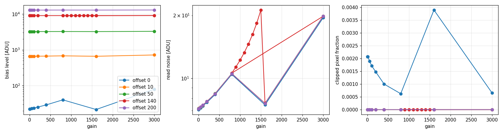
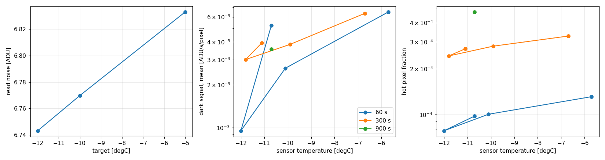
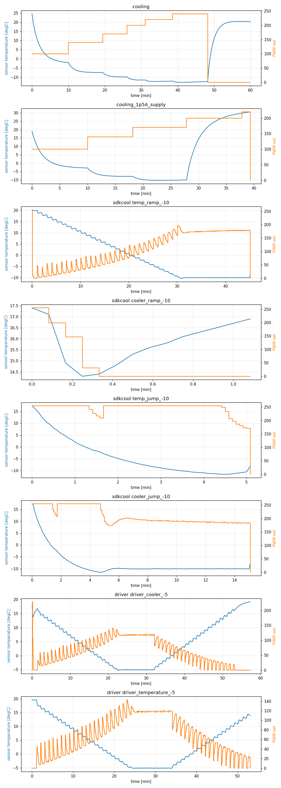

# QHY294PRO-M, serial number cfb85516525f0aced

This report describes what was measured on one QHY294PRO-M (monochrome, cooled CMOS camera) with the characterization
script of pyobs-qhyccd in November 2026, in both read modes of the camera: mode 0 ("11M MODE", 4164 x 2822) and mode 1
("47M MODE", 8336 x 5648). Mode 0 is the main body; the results of mode 1 follow in a subsection of each topic. Notes
that apply to every unit of the model are in the [model notes](../README.md). Data of mode 0 are in this folder, data of
mode 1 in [../cfb85516525f0aced_mode1/](../cfb85516525f0aced_mode1/) (the script writes `_mode1` for read mode 1). The
report is filled in as measurements finish; parts marked "pending" are still to be measured.

Each statement is marked as **measured** (own data, linked below), **inferred** (a conclusion from the data that was not
checked separately) or **from the SDK**. All numbers are for this unit.

## Summary

- **Bias noise** is 7.2 ADU at gain 10 and offset 140 (measured). It grows to 8.4 ADU at gain 400 and 10.5 ADU at gain
  800, falls back to 7.6 ADU at gain 1600 and is 19 ADU at gain 3000. Gain in e-/ADU and read noise in e- are not
  measured yet.
- **Dark current** is 0.045 ADU/s at 10 °C and halves about every 5 °C. Below -5 °C it is at most 0.003 to 0.004 ADU/s,
  close to what the method can resolve. There is no sign of amp glow in the mean (mean only; no images checked by eye).
- **Readout:** 0.6 s per full frame of the effective area, independent of binning (measured).
- **Cooling:** with the 1.5 A supply the cooler stopped working at 66% to 78% drive level (measured, twice). With a
  5 A supply it ran at full drive without trouble and reached -12.8 °C at an ambient of about 20 °C (measured), which is about
  the limit of the cooler. The cause was probably the supply (inferred).
- **Read mode 1 (47M):** bias noise 23 ADU at gain 10 (3 times that of mode 0), 11.4 ADU from gain 200 up; readout 1.4 to
  1.5 s per frame; same share of noisy pixels as mode 0 but a fixed pattern of offset pixels (measured). Offset 0 clips
  98% of the pixels, use 10 or more.
- **Not measured:** gain in e-/ADU, full well, linearity, short exposures.

## Setup

- Linux host, QHY SDK 25.9.29.10, camera on a USB 3.0 port, firmware loaded by the udev rule. Ambient about 20 °C.
- Read mode 0 ("11M MODE", 4164 x 2822), 16 bit, binning 1, USB traffic 60 unless stated otherwise, lens capped.
- Gain 10 and offset 140 for the dark and pixel runs (the pyobs-qhyccd defaults).
- Noise numbers come from the central 2048 x 2048 window; the pixel statistics use the whole effective area.
- All measurements were made with `tools/characterize.py` (see [Reproduce](../../README.md#reproduce)).
- Camera properties and controls as reported by the SDK: [meta.json](meta.json), summarised in the
  [model notes](../README.md#camera-properties).

## Bias and read noise (measured)

Pairs of bias frames (shortest exposure) at 21 °C, noise from the difference of each pair divided by the square root
of 2. Data: [bias.csv](bias.csv).

| Gain | Noise [ADU] | Clipped at offset 0 |
|---|---|---|
| 0 | 7.15 | 0.21% |
| 10 | 7.17 | 0.21% |
| 50 | 7.28 | 0.19% |
| 100 | 7.43 | 0.17% |
| 200 | 7.74 | 0.15% |
| 400 | 8.43 | 0.10% |
| 800 | 10.5 | 0.06% |
| 1600 | 7.58 | 0.39% |
| 3000 | 19 | 0.06% |

- The offset does not change the noise. The bias level is `offset * 64 + 24` ADU (24 ADU at offset 0 and 8984 ADU at
  offset 140 at gain 10 to 100) in read mode 0.
- With offset 10 and higher no pixel is clipped at zero.
- The bias level rises with gain from about gain 200 (8985 ADU at gain 200, 9000 at gain 800, 9039 at gain 3000, all at
  offset 140).
- The noise at gain 1600 is lower than at gain 800. A conversion gain switch would explain it (inferred, no photon
  transfer yet).

### Read mode 1 (47M mode)

Same method as in read mode 0. Data: [bias.csv](../cfb85516525f0aced_mode1/bias.csv).

| Gain | Noise [ADU] | Clipped at offset 0 |
|---|---|---|
| 0 | 22.97 | 98% |
| 10 | 23.28 | 98% |
| 50 | 24.48 | 98% |
| 100 | 26.2 | 98% |
| 200 | 11.4 | 99.8% |
| 400 | 11.8 | 99.8% |
| 800 | 12.7 | 99.8% |
| 1600 | 15.7 | 99.8% |
| 3000 | 38.4 | 99.9% |

- The noise falls from 26 to 11.4 ADU between gain 100 and gain 200. That is the switch of the conversion gain (inferred;
  in read mode 0 the corresponding step is between gain 800 and 1600). A photon transfer measurement would give the noise
  in e-.
- The bias level is `offset * 64 - 38` ADU (602 at offset 10, 8922 at offset 140, 12762 at offset 200), a little below the
  `offset * 64 + 24` of read mode 0. It falls by about 85 ADU from gain 0 to gain 3000 (8922 to 8837).
- **Offset 0 is unusable in read mode 1:** 98% to 99.9% of the pixels are clipped at zero (in mode 0 about 0.2%). Use
  offset 10 or higher.
- The noise does not depend on the offset (offset 10 to 200).

## Readout (measured)

Full effective area read at gain 10, offset 140. Data: [readout.csv](readout.csv).

| USB traffic | Bin 1 [s] | Bin 2 [s] | Bin 4 [s] |
|---|---|---|---|
| 0 | 0.62 | 0.64 | 0.59 |
| 60 | 0.60 | 0.63 | 0.60 |
| 150 | 0.71 | 0.75 | 0.73 |

- Binning gives no speed gain; the time is the same.
- Binning adds the pixels, it does not average them (inferred from the bias level): with offset 140 the bias is 8983
  ADU unbinned, 35930 at bin 2 (4x) and more than 65535 at bin 4 (16x, all pixels saturated). The first run at bin 4 with
  offset 140 is therefore invalid (noise 0.0). A rerun with offset 10 gave valid values (below).
- Noise at gain 10, offset 10 (bias level 662 ADU unbinned, 2650 at bin 2, 10600 at bin 4):

| Bin | Noise [ADU] | Ratio to bin 1 | Square root of the number of pixels |
|---|---|---|---|
| 1 | 7.13 | 1 | 1 |
| 2 | 14.45 | 2.03 | 2 |
| 4 | 30.6 | 4.3 | 4 |

  The noise grows with the square root of the number of pixels (bin 4 is 7% above that), so binning in the camera
  has no read-noise advantage over binning afterwards in software (inferred). It also limits the signal range: a 16 bit
  value saturates at 65535, which is at 1/16 of the unbinned full scale for bin 4.
- The first rows of the readout table above are with offset 140; offset 10 gives the same times (0.56 to 0.71 s).
  Data (both offsets): [readout.csv](readout.csv).

### Read mode 1 (47M mode)

Full effective area (8336 x 5622) read at gain 10 and offset 10 (offset 140 would saturate at bin 4, see mode 0). Data:
[readout.csv](../cfb85516525f0aced_mode1/readout.csv).

| USB traffic | Bin 1 [s] | Bin 2 [s] | Bin 4 [s] | Noise bin 1 / 2 / 4 [ADU] |
|---|---|---|---|---|
| 0 | 1.40 | 1.48 | 1.45 | 23.3 / 46.7 / 95.0 |
| 60 | 1.52 | 1.52 | 1.55 | 23.3 / 46.5 / 95.1 |
| 150 | 1.88 | 1.93 | 1.87 | 23.3 / 46.7 / 95.4 |

- A full frame takes 1.4 to 1.5 s at USB traffic 0 and 60, about 2.5 times the 0.6 s of read mode 0 for four times the
  pixels (mode 0: 0.6 s). USB traffic 150 costs 25% more.
- Binning does not make the readout faster, as in mode 0. The noise is 2.0x at bin 2 and 4.1x at bin 4, so the pixels
  are added and the noise grows with the square root of their number, as in mode 0.
- The bias level at offset 10 differs by 10 ADU between the rows (607, 602, 597 at bin 1). It follows the order of the
  runs, not the USB traffic, so it may be a slow drift of the camera (inferred, not checked).

## Pixels at 20 °C (measured)

60 bias frames (shortest exposure) at gain 10, offset 140, sensor at 20 °C (cooler off). Standard deviation per pixel over the
60 frames. Data: [pixels.csv](pixels.csv).

| Quantity | Value |
|---|---|
| Median per-pixel noise | 6.89 ADU |
| Mean per-pixel noise | 7.01 ADU |
| Pixels with noise above 1.25x the median | 2.2% |
| Pixels with noise above 3x the median | 0.21% |
| Pixels with noise above 5x the median | 0.05% |

There is a small tail of noisy pixels. The pyobs-asi camera has about 1% above 5x for comparison, so this camera shows
less salt-and-pepper noise (different sensor, different measurement date; inferred).

### Read mode 1 (47M mode)

60 bias frames (shortest exposure) of the whole effective area (8336 x 5622 = 46.9 Mpixel) at gain 10, offset 140, sensor
at 20.2 °C (cooler off). Standard deviation per pixel over the 60 frames. Data: [pixels.csv](../cfb85516525f0aced_mode1/pixels.csv). Read mode 0
for comparison (11.6 Mpixel, same settings):

| Quantity | Mode 1 | Mode 0 |
|---|---|---|
| Median per-pixel noise [ADU] | 22.64 | 6.89 |
| Mean / rms per-pixel noise [ADU] | 22.94 / 23.33 | 7.01 / 7.16 |
| 99.9th percentile of the noise [ADU] | 79.7 | 27.7 |
| Pixels with noise above 1.25x the median | 1.8% | 2.2% |
| Pixels with noise above 3x the median | 0.14% | 0.21% |
| Pixels with noise above 5x the median | 0.038% | 0.050% |
| Noisy pixels in the sample on two levels | 3 of 39 | 6 of 47 |
| Pixels whose 60-frame mean is 10 ADU above / below the level | 0.35% / 1.1% | 0.032% / 0.0014% |
| Pixels whose 60-frame mean is 40 ADU above / below the level | 3218 / 253 | 4 / 0 |

- The share of noisy pixels is about the same as in mode 0 (a little lower), so the tail of noisy pixels is not worse
  in the larger mode.
- The 60-frame means scatter more than the noise alone explains. With 22.6 ADU noise the mean of 60 frames has 2.9 ADU
  scatter, so 10 ADU is 3.4 sigma and 0.03% would be expected on each side. Mode 1 has 0.35% above and 1.1% below the
  level, and 3218 pixels more than 40 ADU above it. So there is a fixed pattern (rows, columns or single pixels were not
  examined) that mode 0 does not have in this size. Not checked further.
- The `range_over_45adu` column in `pixels.csv` counts nearly every pixel in mode 1 because the threshold of 45 ADU
  was chosen for the noise of mode 0. Ignore it here.

## Dark current and temperature (measured)

At each target the cooler was held until the sensor was stable, then a pair of 60 s darks and a pair of 300 s darks
were taken at gain 10, offset 140. The dark current is the mean over all pixels, in ADU/s, with the mean of a bias pair
subtracted. The pair is taken before the darks. Two series exist:

- 10, 5, 0, -5, -10 and -12 °C on the 1.5 A supply (17 November, ambient 20 °C, PI controller or SDK auto mode as noted):
  [temperature_1p5A_supply.csv](temperature_1p5A_supply.csv), cooling log [templog_1p5A_supply.csv](templog_1p5A_supply.csv),
  plot [images/temperature_1p5A_supply.png](images/temperature_1p5A_supply.png).
- -5, -10 and -12 °C on the 5 A supply (18 November, PI controller): [temperature.csv](temperature.csv), cooling log
  [templog.csv](templog.csv), plot [images/temperature.png](images/temperature.png).

The supply does not change the dark current at the temperatures where both worked (compare the rows below).

5 A supply (read noise, dark current and hot pixel fraction vs. temperature):

1.5 A supply:

| Setpoint [°C] | Supply | Sensor [°C] | Drive level | Dark 60 s [ADU/s] | Dark 300 s [ADU/s] | Bias noise [ADU] |
|---|---|---|---|---|---|---|
| 10 | 1.5 A | 10.0 | 10% | 0.045 | 0.043 | 7.02 |
| 5 | 1.5 A | 5.0 | 18% | 0.021 | 0.022 | 6.96 |
| 0 | 1.5 A | 0.0 | 26% | 0.010 | 0.011 | 6.88 |
| -5 | 1.5 A | -5.1 / -5.0 | 40% | 0.0038 | 0.0062 | 6.83 |
| -5 | 5 A | -5.7 / -6.7 | 44% / 38% | 0.0065 | 0.0064 | 6.83 |
| -10 | 1.5 A (SDK auto mode) | -10.0 / -10.1 | 55% | 0.0026 | 0.0038 | 6.76 |
| -10 | 1.5 A (PI) | -10.7 / -11.0 | 59% to 61% | 0.0042 | 0.0040 | 6.78 |
| -10 | 5 A | -10.1 / -9.9 | 58% / 59% | 0.0026 | 0.0038 | 6.76 |
| -12 | 1.5 A (PI) | -12.2 / -11.9 | 65% to 66% | 0.0002 | 0.0028 | 6.74 |
| -12 | 5 A | -12.0 / -11.8 | 68% / 69% | 0.0010 | 0.0030 | 6.74 |

- Above 0 °C the dark current halves every 5 °C (0.045, 0.021 and 0.010 ADU/s at 10, 5 and 0 °C). The conversion to e-
  is missing until the gain is measured.
- Below -5 °C it flattens at about 0.003 to 0.004 ADU/s (300 s darks). That is close to what the method can resolve:
  a 300 s dark collects about 1 ADU per pixel, and the median pixel shows 0.000 ADU/s everywhere, so the mean comes
  from a small share of pixels (hot fraction 1e-4 to 3e-4, defined as 20 sigma above the median). Treat 0.003 to
  0.004 ADU/s as an upper bound (inferred).
- The 60 s darks give lower rates than the 300 s darks at -10 and -12 °C, on both supplies, so the supply is not the
  reason. A line through both exposure times gives a rate of about 0.004 ADU/s and an offset of -0.09 ADU at -10 °C and
  0.0035 ADU/s and -0.15 ADU at -12 °C (5 A data), and no offset at -5 °C. An offset of 0.1 ADU between the bias pair and
  the dark frames would explain it, and would hide the real rate in the 60 s darks (inferred, not checked). Longer
  darks (900 s or more) at one or two temperatures would settle it.
- The bias noise falls from 7.02 ADU at 10 °C to 6.74 ADU at -12 °C. The noise of the 300 s darks is 7.1 ADU, against
  6.8 ADU for the 60 s darks (5 A data, -5 to -12 °C).
- The sensor ran 0.7 to 1.7 °C below the setpoint during the -5 °C darks on the 5 A supply (PI controller overshoot),
  so that point is not at -5.0 °C.

### Read mode 1 (47M mode): pending

The temperature series in read mode 1 has not finished yet.

## Cooling and the power supply

**Cause of the earlier collapse (inferred): the 1.5 A supply.** On 17 November the cooler stopped working at about
-12 °C with two control methods (SDK auto mode and a PI controller on the manual PWM limited to 240), see the
[temperature table](#dark-current-and-temperature-measured). The sensor went from -11.9 °C to +2.4 °C within a minute
and then to ambient, with the PWM at 94%. On 18 November a sweep of fixed PWM levels from ambient showed the same with
the 1.5 A supply, and no collapse with a 5 A supply.

Fixed PWM, ascending levels, each held for up to 10 min or until the sensor moved less than 0.1 °C in 3 min. Data:
[cooling_1p5A_supply.jsonl](cooling_1p5A_supply.jsonl) and [cooling.jsonl](cooling.jsonl) (5 A). The idle sensor settles at 20.3 °C, which is taken as the ambient temperature. The sweeps started with the
sensor at 19.1 °C (1.5 A) and 24.5 °C (5 A), lens capped, no exposures.

Top: 5 A supply. Bottom: 1.5 A supply, interrupted by hand at 39 min.

| PWM | Drive level | 1.5 A supply, lowest [°C] | 5 A supply, lowest [°C] |
|---|---|---|---|
| 100 | 39% | -2.9 (not settled) | -2.0 (not settled) |
| 140 | 55% | -7.9 | -7.4 |
| 170 | 67% | -10.3 (settled for 10 min) | -9.8 |
| 200 | 78% | -10.1, then **warming to 29.9 °C within 10 min** | -11.5 |
| 220 | 86% | not run | -12.3 |
| 240 | 94% | not run | -12.8 |

- With the 1.5 A supply the sensor warmed above ambient (20 °C) at PWM 200 and kept the PWM reading of 200. With no
  supply connected at all (unplugged by mistake on 18 November) the sensor also warmed (23.3 to 24.7 °C in 150 s at
  PWM 100, measured), so the electronics alone heat it. The cooler had probably lost its power, not just been overloaded
  (inferred).
- Levels up to 170 gave the same temperatures on both supplies within 0.5 °C. The old supply only failed at the
  highest current. The first collapse was at about 66%, but after 20 min, with a warmer hot side (inferred: the
  current depends on the temperature difference as well as on the drive level).
- The 5 A supply is a different unit (voltage and polarity checked with a multimeter before connecting). The 1.5 A
  supply had a rating of 1.5 A; the current of the camera at full drive was not measured, and the rated current of the
  camera was not looked up.
- Full drive reaches only about 33 °C below ambient (-12.8 °C at about 20 °C ambient). Each step of 20 PWM above 170 gains less
  than 1 °C, so the cooler is near its limit (heat sink and fan, or the TEC itself). -15 °C needs a colder room or
  better heat removal (inferred).
- The qhyccd driver's workaround for "PWM above 250" (see the [model notes](../README.md#cooling)) was not tested
  here. Whether the other QHY cameras that stop cooling are also on too small supplies is open.

**Slow versus fast cooling.** The sweep jumped to each PWM level, so the sensor cooled at about 5 °C per minute at the start of a level. No collapse occurred on the 5 A supply, so the rate does not matter there.

**Bug found in the sweep script.** The collapse check first required a 2 °C drop from the start of the level, which
missed the failure at PWM 200 (the level started at -10.1 °C and never went lower), so the script ran the level for 10
min and started PWM 220 at 30 °C. It was interrupted by hand. The check now needs only a rise of 1 °C above the lowest
temperature of the level. The 1.5 A run in `cooling_1p5A_supply.jsonl` ends with the interrupted PWM 220 level.

## SDK cooling control (5 A supply)

The PI controller of the script and the fixed PWM sweep drive the cooler through `CONTROL_MANULPWM`. The SDK has two
controls of its own: `ControlQHYCCDTemp` (called once per second by the caller) and `SetQHYCCDParam(CONTROL_COOLER,
target)` (set once, the camera regulates). The `sdkcool` step runs each of them to -10 °C, once in steps of 1 °C per minute
("ramp") and once with the target set to -10 °C at once ("jump"), then holds 15 min. It logs the PWM that the SDK chooses
(`CONTROL_CURPWM`) and stops on a collapse (sensor 1 °C above its lowest value). Data: [sdkcool.jsonl](sdkcool.jsonl),
[sdkcool.csv](sdkcool.csv).

| Run | Result |
|---|---|
| `CONTROL_COOLER`, ramp | **Inconclusive.** The run started at 17.4 °C and stopped after 60 s because the script flagged a collapse: the sensor had dropped to 14.2 °C in 15 s (PWM 31 read once), the camera then set the PWM to 0 and the sensor warmed to 16.7 °C, towards the target of 17 °C. That is what a regulator does when the sensor is below the target, so the collapse flag was wrong (the check did not compare with the target). Fixed in the script; to be repeated. |
| `ControlQHYCCDTemp`, jump to -10 °C | Sensor went from 17.4 °C to -11.6 °C in 4.5 min while the SDK drove the PWM at 217 to 255 (85% to 100%). It overshot to -11.6 °C and rose to -10.6 °C, so the script flagged a collapse and stopped at 5 min. That was wrong: the sensor was still below the target (the check at that time looked only at the rise from the lowest value). **Inconclusive for the hold, but at PWM 255 the cooler kept cooling for at least 2 minutes (inferred from -8.9 to -11.6 °C at 255 and 233).** To be repeated with the fixed check. |
| `ControlQHYCCDTemp`, ramp | Reached -10 °C after 31 min and held -10.0 °C for 15 min (lowest -10.3 °C). PWM rose from 5 at 19 °C to 159 at the end of the ramp and settled at 171 to 179 (67% to 70%). No collapse. |

- On the ramp the SDK followed the target within about 1 °C (sensor 0.8 to 1 °C above the target while ramping). The PWM
  was never close to 250. The reading of 255 in the first sample of each run is the unset `CONTROL_CURPWM` (it reads
  garbage until the first PWM is set), not a drive level.
- The SDK needs a higher PWM at -10 °C (about 177) than the PI controller (58% to 59%, about 150) and than the fixed sweep
  (170 gives -9.8 °C). Why is not known; the PWM that `CONTROL_CURPWM` reports may not have the same scale as the manual PWM
  (not checked).

## Not measured yet

- **Gain** (`gain` step, warm, about 1 h): e-/ADU, read noise in e- and full well per gain, including the step near
  gain 1600. Because dark current is so small, a flat field (`flat` step) is the more reliable source.
- **Flat and short** exposures (`flat`, `short`): need a uniform light source. Linearity and the real exposure time of
  short exposures.
- **Read mode 1:** temperature series, cold pixels and gain (the other steps are in the subsections above).
- **Temperature below -13 °C:** not reachable at about 20 °C ambient (see [Cooling](#cooling-and-the-power-supply)).
- **Dark current below -5 °C** with longer darks (900 s or more), to settle the 60 s versus 300 s difference described
  under [Dark current](#dark-current-and-temperature-measured).
- **The SDK's own cooling control** (`ControlQHYCCDTemp`, `CONTROL_COOLER`) on the 5 A supply. All measurements here
  used the PI controller on the manual PWM, so the driver's park-and-retry workaround is not yet judged.

## Notes on the script

- `tools/characterize.py` talks to the SDK directly with ctypes, as the Cython driver does not expose min/max/step of the
  controls or the read modes.
- The temperature ramp starts from the sensor temperature if the cooler has no target or the sensor is more than 2 °C
  above the setpoint. The warm-up after a `CoolerLimit` stop used to fail with a second `CoolerLimit` from a stale
  target; fixed in this session (not tested on a camera that stopped cooling again).
- `frames/` holds FITS cutouts and is ignored by git, like `*.log` under `characterization/` (`.gitignore`).
