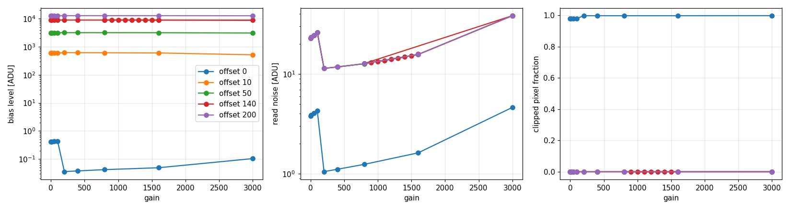
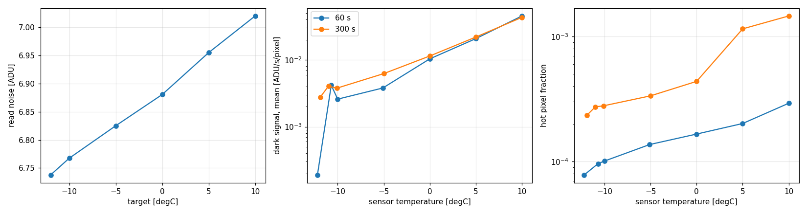
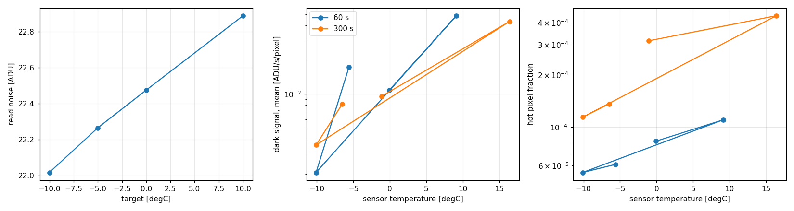
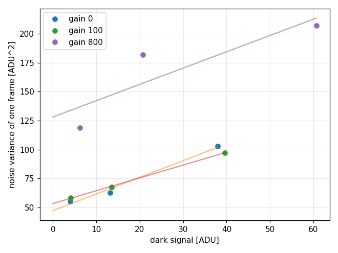
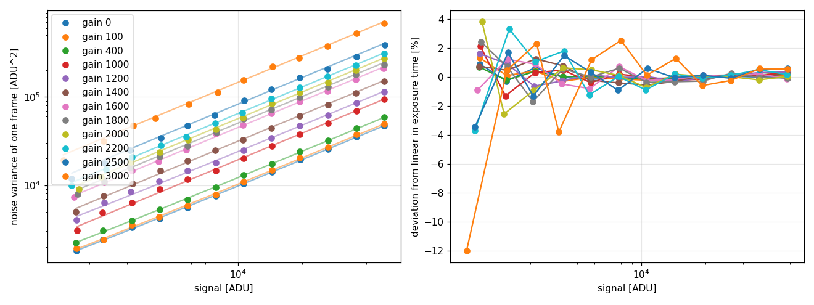
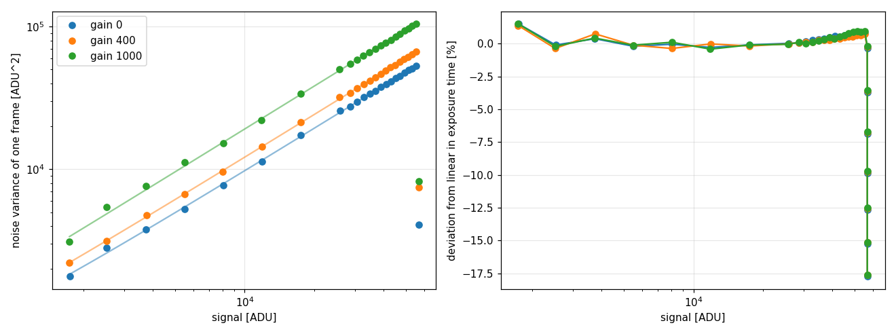
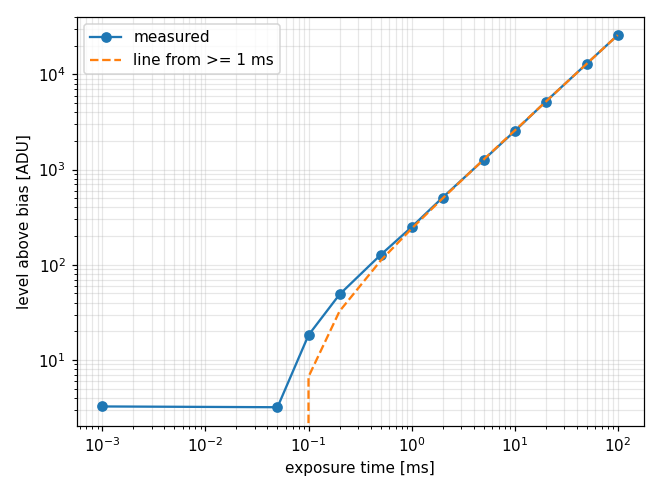

# QHY294PRO-M, serial number cfb85516525f0aced

This report describes what was measured on one QHY294PRO-M (monochrome, cooled CMOS camera) with the characterization
script of pyobs-qhyccd in November 2026, in both read modes of the camera: mode 0 ("11M MODE", 4164 x 2822) and mode 1
("47M MODE", 8336 x 5648). Mode 0 is the main body; the results of mode 1 follow in a subsection of each topic. Notes
that apply to every unit of the model are in the [model notes](../README.md). Data of mode 0 are in this folder, data of
mode 1 in [../cfb85516525f0aced_mode1/](../cfb85516525f0aced_mode1/) (the script writes `_mode1` for read mode 1). The
report is filled in as measurements finish; parts marked "pending" are still to be measured.

Each statement is marked as **measured** (own data, linked below), **inferred** (a conclusion from the data that was not
checked separately) or **from the SDK**. All numbers are for this unit.

## Summary

- **Bias noise** is 7.2 ADU at gain 10 and offset 140 (measured). It grows to 8.4 ADU at gain 400 and 10.5 ADU at gain
  800, falls back to 7.6 ADU at gain 1600 and is 19 ADU at gain 3000. The conversion gain (flat fields, errors 1 to 2%)
  is 1.03 e-/ADU at gain 0, 0.98 at 100, 0.83 at 400, 0.51 at 1000, 0.22 at 1600, 0.175 at 2000 and 0.068 at 3000, so the
  read noise is about 7.2 e- at gains 0 to 400 and 1.7 e- at gain 1600 (see
  [Gain and linearity](#gain-and-linearity-from-flat-fields-measured)). The drop in e- looks like a switch of the
  conversion gain between gain 1500 and 1600 (the bias noise falls from 21 to 7.6 ADU there, measured; the e- are inferred).
- **Dark current** is 0.045 ADU/s at 10 °C and halves about every 5 °C. At -10 °C it is about 0.0037 ADU/s (300 s and
  900 s darks), and at -5 °C about 0.006 ADU/s (measured). There is no sign of amp glow in the mean (mean only; no images checked by eye).
  Mode 1 has a quarter of that per pixel in electrons (0.0008 e-/s at -12 °C against 0.0033), the same per sensor area
  (inferred).
- **Readout:** 0.6 s per full frame of the effective area, independent of binning (measured).
- **Cooling:** with the 1.5 A supply the cooler stopped working at 66% to 78% drive level (measured, twice). With a
  5 A supply it ran at full drive without trouble and reached -12.8 °C at an ambient of about 20 °C (measured), which is about
  the limit of the cooler. The cause was probably the supply (inferred).
- **Read mode 1 (47M):** bias noise 23 ADU at gain 10 (3 times that of mode 0), 11.4 ADU from gain 200 up; readout 1.4 to
  1.5 s per frame; same share of noisy pixels as mode 0 but a fixed pattern of offset pixels (measured). Offset 0 clips
  98% of the pixels, use 10 or more.
- **Read mode 1** has 0.32 e-/ADU at gain 0 (3 times lower than mode 0), the same 7.4 e- read noise at gains 0 and 100
  and about 2.5 e- from gain 200 up (switch between gain 100 and 200, inferred).
- **Linearity and short exposures:** with a steady artificial light (0.18% per minute) the response is linear within
  0.3% above 4000 ADU at gains 0 to 400 and within 1% up to gain 2000, in both modes (measured). Linear in exposure time
  down to 5 ms; times of 1 ms and shorter carry about 0.1 ms of extra signal at most.
- **Full well:** the ADC clips at 65535 ADU before the pixels saturate (linear to 64000 ADU, no roll-off). The range
  above the bias is 58 ke- at gain 0 in mode 0 and 18 ke- in mode 1; the true full well is at least that (inferred).
- **Camera hang:** reproduced with `CloseQHYCCD` followed by opening in the other read mode (about 3% per switch);
  opening in the other mode and back clears it without a replug. At the telescope most hangs started in a running
  session without either, about one per 3000 exposures; that trigger is not reproduced (see
  [Camera hang](#camera-hang-with-empty-frames-open-problem)).
- **Not measured:** the bias noise at gains 1000 to 1400 (where the conversion gain switches in mode 0).

## Setup

- Linux host, QHY SDK 25.9.29.10, camera on a USB 3.0 port, firmware loaded by the udev rule. Ambient about 20 °C.
- Read mode 0 ("11M MODE", 4164 x 2822), 16 bit, binning 1, USB traffic 60 unless stated otherwise, lens capped.
- Gain 10 and offset 140 for the dark and pixel runs (the pyobs-qhyccd defaults).
- Noise numbers come from the central 2048 x 2048 window; the pixel statistics use the whole effective area.
- All measurements were made with `tools/characterize.py` (see [Reproduce](../../README.md#reproduce)).
- Camera properties and controls as reported by the SDK: [meta.json](meta.json), summarised in the
  [model notes](../README.md#camera-properties).

## Bias and read noise (measured)

Pairs of bias frames (shortest exposure) at 21 °C, noise from the difference of each pair divided by the square root
of 2. Data: [bias.csv](bias.csv).

| Gain | Noise [ADU] | Clipped at offset 0 |
|---|---|---|
| 0 | 7.15 | 0.21% |
| 10 | 7.17 | 0.21% |
| 50 | 7.28 | 0.19% |
| 100 | 7.43 | 0.17% |
| 200 | 7.74 | 0.15% |
| 400 | 8.43 | 0.10% |
| 800 | 10.5 | 0.06% |
| 1600 | 7.58 | 0.39% |
| 3000 | 19 | 0.06% |

- The offset does not change the noise. The bias level is `offset * 64 + 24` ADU (24 ADU at offset 0 and 8984 ADU at
  offset 140 at gain 10 to 100) in read mode 0.
- With offset 10 and higher no pixel is clipped at zero.
- The bias level rises with gain from about gain 200 (8985 ADU at gain 200, 9000 at gain 800, 9039 at gain 3000, all at
  offset 140).
- The noise at gain 1600 is lower than at gain 800. A conversion gain switch would explain it (inferred, no photon
  transfer yet).

### Read mode 1 (47M mode)

Same method as in read mode 0. Data: [bias.csv](../cfb85516525f0aced_mode1/bias.csv).

| Gain | Noise [ADU] | Clipped at offset 0 |
|---|---|---|
| 0 | 22.97 | 98% |
| 10 | 23.28 | 98% |
| 50 | 24.48 | 98% |
| 100 | 26.2 | 98% |
| 200 | 11.4 | 99.8% |
| 400 | 11.8 | 99.8% |
| 800 | 12.7 | 99.8% |
| 1600 | 15.7 | 99.8% |
| 3000 | 38.4 | 99.9% |

- The noise falls from 26 to 11.4 ADU between gain 100 and gain 200. That is the switch of the conversion gain (inferred;
  in read mode 0 the corresponding step is between gain 800 and 1600). A photon transfer measurement would give the noise
  in e-.
- The bias level is `offset * 64 - 38` ADU (602 at offset 10, 8922 at offset 140, 12762 at offset 200), a little below the
  `offset * 64 + 24` of read mode 0. It falls by about 85 ADU from gain 0 to gain 3000 (8922 to 8837).
- **Offset 0 is unusable in read mode 1:** 98% to 99.9% of the pixels are clipped at zero (in mode 0 about 0.2%). Use
  offset 10 or higher.
- The noise does not depend on the offset (offset 10 to 200).

## Bias noise across the conversion gain switch (measured)

Bias pairs at offset 140, gains 800 to 1600 in steps of 100, lens capped, sensor about 22 °C, 2048 x 2048 window.
Data: [bias.jsonl](bias.jsonl) and [bias.jsonl of mode 1](../cfb85516525f0aced_mode1/bias.jsonl).

| Gain | Mode 0 noise [ADU] | Mode 0 bias level | Mode 1 noise [ADU] |
|---|---|---|---|
| 800 | 10.58 | 9000.0 | 12.76 |
| 900 | 11.34 | 9004.0 | 13.10 |
| 1000 | 12.21 | 9008.7 | 13.39 |
| 1100 | 13.27 | 9014.4 | 13.68 |
| 1200 | 14.56 | 9021.0 | 14.05 |
| 1300 | 16.22 | 9029.7 | 14.41 |
| 1400 | 18.33 | 9040.9 | 14.82 |
| 1500 | 21.23 | 9056.2 | 15.30 |
| 1600 | 7.60 | 8981.3 | 15.82 |

- **Mode 0 switches between gain 1500 and 1600** (measured): the noise falls from 21.2 to 7.6 ADU and the bias level falls
  by 75 ADU. In e- (times the conversion gain from the flats) the noise is 6.3 e- at gain 1000, 5.9 e- at 1400, 5.8 e- at 1500
  and 1.7 e- at 1600. So gain 1600 is the lowest setting with the low-noise conversion gain
  (inferred from the e- values, the switch itself is only seen in the noise).
- **Mode 1 shows no switch in 800 to 1600** (noise rises smoothly from 12.8 to 15.8 ADU). Its drop lies between gain 100
  and 200 (26.2 to 11.4 ADU, see the mode 1 table above). A scan in steps of 10 puts it **between gain 190 and 200**
  (30.2 to 11.4 ADU, bias level 8902 to 8934 ADU; measured).
- A mode 0 scan in steps of 10 from 1510 to 1590 shows the noise rising from 21.4 to 24.7 ADU with no earlier step, so the
  switch is **between gain 1590 and 1600** (measured). So the low-noise conversion gain starts at gain 1600 in mode 0 and at
  gain 200 in mode 1.
- Below the switch the read noise in e- falls slowly with gain (7.4 e- at 0, 5.7 e- at 1500); the ADU noise growth is the
  falling e-/ADU.

## Readout (measured)

Full effective area read at gain 10, offset 140. Data: [readout.csv](readout.csv).

| USB traffic | Bin 1 [s] | Bin 2 [s] | Bin 4 [s] |
|---|---|---|---|
| 0 | 0.62 | 0.64 | 0.59 |
| 60 | 0.60 | 0.63 | 0.60 |
| 150 | 0.71 | 0.75 | 0.73 |

- Binning gives no speed gain; the time is the same.
- Binning adds the pixels, it does not average them (inferred from the bias level): with offset 140 the bias is 8983
  ADU unbinned, 35930 at bin 2 (4x) and more than 65535 at bin 4 (16x, all pixels saturated). The first run at bin 4 with
  offset 140 is therefore invalid (noise 0.0). A rerun with offset 10 gave valid values (below).
- Noise at gain 10, offset 10 (bias level 662 ADU unbinned, 2650 at bin 2, 10600 at bin 4):

| Bin | Noise [ADU] | Ratio to bin 1 | Square root of the number of pixels |
|---|---|---|---|
| 1 | 7.13 | 1 | 1 |
| 2 | 14.45 | 2.03 | 2 |
| 4 | 30.6 | 4.3 | 4 |

  The noise grows with the square root of the number of pixels (bin 4 is 7% above that), so binning in the camera
  has no read-noise advantage over binning afterwards in software (inferred). It also limits the signal range: a 16 bit
  value saturates at 65535, which is at 1/16 of the unbinned full scale for bin 4.
- The first rows of the readout table above are with offset 140; offset 10 gives the same times (0.56 to 0.71 s).
  Data (both offsets): [readout.csv](readout.csv).

### Read mode 1 (47M mode)

Full effective area (8336 x 5622) read at gain 10 and offset 10 (offset 140 would saturate at bin 4, see mode 0). Data:
[readout.csv](../cfb85516525f0aced_mode1/readout.csv).

| USB traffic | Bin 1 [s] | Bin 2 [s] | Bin 4 [s] | Noise bin 1 / 2 / 4 [ADU] |
|---|---|---|---|---|
| 0 | 1.40 | 1.48 | 1.45 | 23.3 / 46.7 / 95.0 |
| 60 | 1.52 | 1.52 | 1.55 | 23.3 / 46.5 / 95.1 |
| 150 | 1.88 | 1.93 | 1.87 | 23.3 / 46.7 / 95.4 |

- A full frame takes 1.4 to 1.5 s at USB traffic 0 and 60, about 2.5 times the 0.6 s of read mode 0 for four times the
  pixels (mode 0: 0.6 s). USB traffic 150 costs 25% more.
- Binning does not make the readout faster, as in mode 0. The noise is 2.0x at bin 2 and 4.1x at bin 4, so the pixels
  are added and the noise grows with the square root of their number, as in mode 0.
- The bias level at offset 10 differs by 10 ADU between the rows (607, 602, 597 at bin 1). It follows the order of the
  runs, not the USB traffic, so it may be a slow drift of the camera (inferred, not checked).

## Pixels at 20 °C (measured)

60 bias frames (shortest exposure) at gain 10, offset 140, sensor at 20 °C (cooler off). Standard deviation per pixel over the
60 frames. Data: [pixels.csv](pixels.csv).

| Quantity | Value |
|---|---|
| Median per-pixel noise | 6.89 ADU |
| Mean per-pixel noise | 7.01 ADU |
| Pixels with noise above 1.25x the median | 2.2% |
| Pixels with noise above 3x the median | 0.21% |
| Pixels with noise above 5x the median | 0.05% |

There is a small tail of noisy pixels. The pyobs-asi camera has about 1% above 5x for comparison, so this camera shows
less salt-and-pepper noise (different sensor, different measurement date; inferred).

### Read mode 1 (47M mode)

60 bias frames (shortest exposure) of the whole effective area (8336 x 5622 = 46.9 Mpixel) at gain 10, offset 140, sensor
at 20.2 °C (cooler off). Standard deviation per pixel over the 60 frames. Data: [pixels.csv](../cfb85516525f0aced_mode1/pixels.csv). Read mode 0
for comparison (11.6 Mpixel, same settings):

| Quantity | Mode 1 | Mode 0 |
|---|---|---|
| Median per-pixel noise [ADU] | 22.64 | 6.89 |
| Mean / rms per-pixel noise [ADU] | 22.94 / 23.33 | 7.01 / 7.16 |
| 99.9th percentile of the noise [ADU] | 79.7 | 27.7 |
| Pixels with noise above 1.25x the median | 1.8% | 2.2% |
| Pixels with noise above 3x the median | 0.14% | 0.21% |
| Pixels with noise above 5x the median | 0.038% | 0.050% |
| Noisy pixels in the sample on two levels | 3 of 39 | 6 of 47 |
| Pixels whose 60-frame mean is 10 ADU above / below the level | 0.35% / 1.1% | 0.032% / 0.0014% |
| Pixels whose 60-frame mean is 40 ADU above / below the level | 3218 / 253 | 4 / 0 |

- The share of noisy pixels is about the same as in mode 0 (a little lower), so the tail of noisy pixels is not worse
  in the larger mode.
- The 60-frame means scatter more than the noise alone explains. With 22.6 ADU noise the mean of 60 frames has 2.9 ADU
  scatter, so 10 ADU is 3.4 sigma and 0.03% would be expected on each side. Mode 1 has 0.35% above and 1.1% below the
  level, and 3218 pixels more than 40 ADU above it. So there is a fixed pattern (rows, columns or single pixels were not
  examined) that mode 0 does not have in this size. Not checked further.
- The `range_over_45adu` column in `pixels.csv` counts nearly every pixel in mode 1 because the threshold of 45 ADU
  was chosen for the noise of mode 0. Ignore it here.

### Cooled to -10 °C (read mode 0)

The same measurement with the sensor held at -10.0 °C (5 A supply, PI controller). Data:
[pixels.csv](pixels.csv) (the record with target -10).

| Quantity | 20 °C | -10 °C |
|---|---|---|
| Median per-pixel noise [ADU] | 6.89 | 6.45 |
| Mean / rms per-pixel noise [ADU] | 7.01 / 7.16 | 6.59 / 6.78 |
| 99.9th percentile of the noise [ADU] | 27.7 | 29.2 |
| Pixels with noise above 1.25x the median | 2.2% | 2.6% |
| Pixels with noise above 3x the median | 0.21% | 0.28% |
| Pixels with noise above 5x the median | 0.050% | 0.075% |
| Noisy pixels in the sample on two levels | 6 of 47 | 9 of 80 |
| Pixels whose 60-frame mean is 10 ADU above / below the level | 3734 / 166 | 5085 / 207 |

- The typical pixel is 6% quieter when cold (6.89 to 6.45 ADU), as the bias noise of the frames (7.02 to 6.77 ADU) suggests.
- The noisy tail does not go away with cooling: it is slightly larger, in share of pixels above 3x and 5x the median.
  The median fell, but the tail did not, which fits random telegraph noise that does not depend on temperature much
  (inferred, as in the pyobs-asi measurements). 11% of the noisy pixels of the sample sit on two levels, about as at
  20 °C (13%).
- The number of pixels more than 10 ADU away from the level is 36% higher at -10 °C (5085, against 3734 above). No dark
  current is involved with these shortest exposures, so this is a fixed pattern of the readout that grows slightly with
  cooling, or the same pixels counted against the smaller noise (not checked).

### Cooled to -10 °C (read mode 1)

Same as for mode 0, sensor at -9.9 °C, 49 noisy pixels in the sample. Data: [pixels.csv](../cfb85516525f0aced_mode1/pixels.csv).

| Quantity | 20 °C | -10 °C |
|---|---|---|
| Median per-pixel noise [ADU] | 22.64 | 21.26 |
| Mean / rms per-pixel noise [ADU] | 22.94 / 23.33 | 21.59 / 22.07 |
| 99.9th percentile of the noise [ADU] | 79.7 | 84.2 |
| Pixels with noise above 1.25x the median | 1.8% | 2.2% |
| Pixels with noise above 3x the median | 0.14% | 0.18% |
| Pixels with noise above 5x the median | 0.038% | 0.055% |
| Noisy pixels in the sample on two levels | 3 of 39 | 4 of 49 |
| Pixels whose 60-frame mean is 10 ADU above / below the level | 164851 / 515420 | 133534 / 216153 |
| Pixels whose 60-frame mean is 40 ADU above / below the level | 3218 / 253 | 4485 / 351 |

- The typical pixel is 6% quieter when cold (22.64 to 21.26 ADU), as in mode 0. The noisy tail grows slightly with
  cooling, also as in mode 0 (0.038% to 0.055% above 5x the median).
- The pixels with an offset of more than 10 ADU below the level fall from 515420 to 216153 (1.1% to 0.46%) when cold, and
  those above fall from 164851 to 133534, but the counts above 20 and 40 ADU grow. So the fixed pattern of mode 1 seen
  at 20 °C is partly temperature dependent. Its shape (rows, columns, single pixels) was not examined.
- Compared with mode 0 at -10 °C, mode 1 has about the same noisy share (0.055% against 0.075% above 5x) and far more
  offset pixels.

## Dark current and temperature (measured)

At each target the cooler was held until the sensor was stable, then a pair of 60 s darks and a pair of 300 s darks
were taken at gain 10, offset 140. The dark current is the mean over all pixels, in ADU/s, with the mean of a bias pair
subtracted. The pair is taken before the darks. Two series exist:

- 10, 5, 0, -5, -10 and -12 °C on the 1.5 A supply (17 November, ambient 20 °C, PI controller or SDK auto mode as noted):
  [temperature_1p5A_supply.csv](temperature_1p5A_supply.csv), cooling log [templog_1p5A_supply.csv](templog_1p5A_supply.csv),
  plot [images/temperature_1p5A_supply.png](images/temperature_1p5A_supply.png).
- -5, -10 and -12 °C on the 5 A supply (18 November, PI controller): [temperature.csv](temperature.csv), cooling log
  [templog.csv](templog.csv), plot [images/temperature.png](images/temperature.png).

The supply does not change the dark current at the temperatures where both worked (compare the rows below).

5 A supply (read noise, dark current and hot pixel fraction vs. temperature):

1.5 A supply:

| Setpoint [°C] | Supply | Sensor [°C] | Drive level | Dark 60 s [ADU/s] | Dark 300 s [ADU/s] | Bias noise [ADU] |
|---|---|---|---|---|---|---|
| 10 | 1.5 A | 10.0 | 10% | 0.045 | 0.043 | 7.02 |
| 5 | 1.5 A | 5.0 | 18% | 0.021 | 0.022 | 6.96 |
| 0 | 1.5 A | 0.0 | 26% | 0.010 | 0.011 | 6.88 |
| -5 | 1.5 A | -5.1 / -5.0 | 40% | 0.0038 | 0.0062 | 6.83 |
| -5 | 5 A | -5.7 / -6.7 | 44% / 38% | 0.0065 | 0.0064 | 6.83 |
| -10 | 1.5 A (SDK auto mode) | -10.0 / -10.1 | 55% | 0.0026 | 0.0038 | 6.76 |
| -10 | 1.5 A (PI) | -10.7 / -11.0 | 59% to 61% | 0.0042 | 0.0040 | 6.78 |
| -10 | 5 A | -10.1 / -9.9 | 58% / 59% | 0.0026 | 0.0038 | 6.76 |
| -12 | 1.5 A (PI) | -12.2 / -11.9 | 65% to 66% | 0.0002 | 0.0028 | 6.74 |
| -12 | 5 A | -12.0 / -11.8 | 68% / 69% | 0.0010 | 0.0030 | 6.74 |

- Above 0 °C the dark current halves every 5 °C (0.045, 0.021 and 0.010 ADU/s at 10, 5 and 0 °C). The conversion to e-
  is missing until the gain is measured.
- Below -5 °C it flattens at about 0.003 to 0.004 ADU/s (300 s darks). That is close to what the method can resolve:
  a 300 s dark collects about 1 ADU per pixel, and the median pixel shows 0.000 ADU/s everywhere, so the mean comes
  from a small share of pixels (hot fraction 1e-4 to 3e-4, defined as 20 sigma above the median). Treat 0.003 to
  0.004 ADU/s as an upper bound (inferred).
- **900 s darks at 0, -5 and -12 °C (mode 0, 5 A supply, 24 Nov):** 0.0121, 0.0057 and 0.0032 ADU/s (mean), median
  0.0111, 0.0022 and 0.0022 ADU/s, hot fraction 2.1e-3, 1.3e-3 and 4.5e-4, bias noise 6.90, 6.82 and 6.74 ADU. These agree
  with the 300 s values above (0.011, 0.0064, 0.0030). **The sensor temperature in the records is wrong for the first
  two** (-12.1 and -8.2 °C instead of 0 and -5 °C, with power 0 and 22%): the log has no sample during the three 900 s
  exposures and the reading after them is not trustworthy (cause not found). The cooler had held 0.0 and -5.1 °C at 32% and
  41% before the darks and the dark currents match those temperatures, so I take the setpoints (inferred).
- **Longer darks (5 A supply, -10 °C, 60 / 300 / 900 s):** 0.0052 / 0.0039 / 0.0036 ADU/s at -10.7 / -11.1 / -10.7 °C,
  bias noise 6.77 ADU, hot fraction 1e-4 / 3e-4 / 5e-4, dark noise 6.77 / 6.97 / 7.75 ADU. The 300 s and 900 s values
  agree, and the three 300 s or longer darks at -10 °C (0.0038, 0.0039, 0.0036) are within 10%. So the dark current at
  -10 °C is about 0.0037 ADU/s (measured). The 60 s values scatter between 0.0026 and 0.0052 ADU/s in different runs;
  a 60 s dark collects only 0.2 ADU per pixel, so single 60 s pairs are not reliable at this level. My earlier idea of an
  offset of 0.1 ADU between the bias pair and the dark frames is not supported: this run has the 60 s value above the
  300 s one.
- The dark noise grows with exposure time (6.77, 6.97, 7.75 ADU) as the dark signal adds shot noise and hot pixels
  appear. If it were shot noise only, the excess variance per mean dark signal would give a gain of roughly 0.2 to
  0.4 e-/ADU at gain 10, but the hot pixels add to the mean in a non-Poissonian way, so this is a rough hint at most
  (inferred, not a measurement).
- The bias noise falls from 7.02 ADU at 10 °C to 6.74 ADU at -12 °C. The noise of the 300 s darks is 7.1 ADU, against
  6.8 ADU for the 60 s darks (5 A data, -5 to -12 °C).
- The sensor ran 0.7 to 1.7 °C below the setpoint during the -5 °C darks on the 5 A supply (PI controller overshoot),
  so that point is not at -5.0 °C.

### Read mode 1 (47M mode)

Same procedure as above (5 A supply, PI controller, gain 10, offset 140, 60 s and 300 s darks, ambient 20 °C). Data:
[temperature.csv](../cfb85516525f0aced_mode1/temperature.csv), cooling log
[templog.csv](../cfb85516525f0aced_mode1/templog.csv), plot
[images/temperature.png](../cfb85516525f0aced_mode1/images/temperature.png).

| Setpoint [°C] | Sensor [°C] | Drive level | Dark 60 s [ADU/s] | Dark 300 s [ADU/s] | Bias noise [ADU] |
|---|---|---|---|---|---|
| -5 | -5.6 / -6.5 | 44% / 38% | 0.0172 | 0.0082 | 22.26 |
| -10 | -10.1 / -10.1 | 59% | 0.0021 | 0.0036 | 22.02 |
| 0 | -0.1 / -1.1 | 28% | 0.0108 | 0.0096 | 22.47 |
| 10 | 9.1 / 16.4 | 8% / 52% | 0.0486 | 0.0434 | 22.89 |

- At -10 °C the dark current per pixel is 0.0036 ADU/s (300 s), the same as in read mode 0 (0.0037 ADU/s from 300 s and
  900 s darks). The 60 s value is lower at -10 °C and much higher at -5 °C (0.0172, against 0.0065 in mode 0), so the 60 s
  pairs scatter by more than the 300 s darks, as in mode 0 (the hot fraction is also lower at 60 s).
- At -5 °C the 300 s dark gives 0.0082 ADU/s, a little above mode 0 (0.0064). The sensor was 1 °C colder during the 300 s
  dark than the setpoint, so the temperatures are not exactly the same. Two points are too few for an activation energy.
- The bias noise falls from 22.26 to 22.02 ADU between -5 and -10 °C (6.83 to 6.77 ADU in mode 0).
- **900 s darks at 0, -5 and -12 °C (mode 1, 5 A supply, 25 Nov):** 0.0093, 0.0049 and 0.0026 ADU/s (mean), hot
  fraction 6.9e-4, 4.5e-4 and 3.0e-4, bias noise 22.47, 22.23 and 21.94 ADU. As in mode 0, the sensor temperature in the
  records is wrong for the first (-7.6 °C at the 0 °C setpoint, power 0%), so I take the setpoints (inferred). The other
  two read -6.3 and -11.8 °C.
- **Per electron** (e-/ADU at gain 10 interpolated from the flats: 0.318 in mode 1, 1.027 in mode 0, inferred):

  | Setpoint [°C] | Mode 1 [e-/s/px] | Mode 0 [e-/s/px] | Ratio |
  |---|---|---|---|
  | 0 | 0.0030 | 0.0124 | 4.2 |
  | -5 | 0.0016 | 0.0059 | 3.8 |
  | -12 | 0.0008 | 0.0033 | 4.0 |

  Mode 0 has 4 times the dark current per pixel. A pixel of mode 0 covers 4 pixels of mode 1 (2x2, 4164 x 2822 against
  8336 x 5648), so per sensor area the dark current is the same in both modes (inferred from the pixel counts).

## Gain from the dark shot noise, warm (measured, not usable)

The `gain` step measures the variance of the difference of two dark frames against the mean dark signal (photon
transfer without light, cooler off, sensor at 17.6 to 17.9 °C, offset 140, read mode 0). The slope of variance over signal
is 1 / gain in e-/ADU. Exposures 30, 100 and 300 s. Data: [gain.jsonl](gain.jsonl), plot: [images/gain.png](images/gain.png).

| Gain | Mean signal at 30 / 100 / 300 s [ADU] | Variance at 30 / 100 / 300 s [ADU^2] | Slope [ADU^2/ADU] | e-/ADU | Intercept, noise [ADU] |
|---|---|---|---|---|---|
| 0 | 4.0 / 13.1 / 38.0 | 55.4 / 62.9 / 102.8 | 1.44 | 0.70 | 6.9 |
| 100 | 4.1 / 13.5 / 39.6 | 58.4 / 67.7 / 97.4 | 1.11 | 0.90 | 7.3 |
| 800 | 6.2 / 20.7 / 60.7 | 119.0 / 181.9 / 207.1 | 1.41 | 0.71 | 11.3 |

- The intercepts agree with the bias noise (7.15, 7.43 and 10.5 ADU at gains 0, 100 and 800), so the read noise part
  of the fit is right.
- **The gain values are not trustworthy.** 0.70, 0.90 and 0.71 e-/ADU for gains 0, 100 and 800 do not fall with
  gain as they should, and the 800 value should be clearly lower than the gain 0 one (the read noise grows only 1.5 times
  in ADU). The dark signal is only 4 to 60 ADU, the fit uses three points, and hot pixels and noisy pixels add
  variance that is not shot noise (inferred). The scatter between gains (0.7 to 0.9) is the uncertainty of this method.
- Earlier I estimated roughly 0.2 to 0.4 e-/ADU at gain 10 from the cold dark noise. That is not consistent with these
  numbers (0.7 to 0.9), which confirms that neither estimate is reliable.
- The real gain came from flat fields, see the next section.

## Gain and linearity from flat fields (measured)

The `flat` step takes pairs of frames at 12 exposure times that cover 3% to 85% of the full scale (offset 140,
2048 x 2048 window, cooler off, sensor at about 22 °C). The ladder measures the bias with the shortest exposure first.
Pairs are drift corrected (the second frame is scaled by the ratio of the means) and the noise variance of one frame is
the variance of the difference over two. The slope of variance over signal is 1 / gain in e-/ADU, fitted with weights of
1/variance. Pairs with more than 2% drift and saturated pairs are left out. Light source: an artificial light that was
checked first (trend 0.18% per minute, 0.11% frame to frame over 30 s). Data: [flat.jsonl](flat.jsonl), plot:
[images/flat.png](images/flat.png).

Read mode 0:

| Gain | e-/ADU | Error | Max. nonlinearity above 4000 ADU | Read noise [e-] | Range above bias [ke-] |
|---|---|---|---|---|---|
| 0 | 1.032 | 0.9% | 0.15% | 7.4 | 58 |
| 100 | 0.982 | 1.2% | 0.31% | 7.3 | 56 |
| 400 | 0.829 | 0.9% | 0.24% | 7.0 | 47 |
| 1000 | 0.518 | 1.0% | 0.48% | 6.3 | 29 |
| 1100 | 0.471 | 0.8% | not checked | 6.3 | 27 |
| 1200 | 0.419 | 1.2% | 0.35% | 6.1 | 24 |
| 1300 | 0.372 | 0.9% | not checked | 6.0 | 21 |
| 1400 | 0.322 | 0.8% | 0.77% | 5.9 | 18 |
| 1500 | 0.273 | 0.9% | not checked | 5.8 | 16 |
| 1600 | 0.221 | 1.4% | 0.81% | 1.7 | 13 |
| 1800 | 0.197 | 1.4% | 0.60% | not measured | 11 |
| 2000 | 0.175 | 1.4% | 0.73% | not measured | 9.9 |
| 2200 | 0.154 | 1.1% | 1.8% | not measured | 8.7 |
| 2500 | 0.120 | 1.3% | 1.5% | not measured | 6.8 |
| 3000 | 0.068 | 1.1% | 3.8% | 1.35 | 3.9 |

Read mode 1 (same method, 8336 x 5648 pixels, 2048 x 2048 window):

| Gain | e-/ADU | Error | Max. nonlinearity above 4000 ADU | Read noise [e-] | Range above bias [ke-] |
|---|---|---|---|---|---|
| 0 | 0.323 | 0.6% | 0.44% | 7.4 | 18 |
| 100 | 0.275 | 0.2% | 0.46% | 7.2 | 16 |
| 400 | 0.210 | 0.7% | 0.26% | 2.5 | 12 |
| 1000 | 0.172 | 0.4% | 0.19% | not measured | 9.7 |

- **Gains 1000 to 1500** are two or three runs each (the first of 1000, 1200 and 1400 plus the repeats in
  [flat_repeat.jsonl](flat_repeat.jsonl), 25 Nov); the runs agree within 2% and the table shows the fit over all runs
  (error 0.8 to 1.2%). The nonlinearity column is from the first run only.
- Read noise in e- is the bias noise in ADU at offset 140 (table in [Bias and read noise](#bias-and-read-noise-measured))
  times the conversion gain. The intercept of the photon transfer fit is not used (it is 0 to 17 ADU and jumps between
  gains, so it is not a read noise).
- **Conversion gain switch (inferred, not checked directly).** The read noise in e- falls from about 7 e- (gain 400) to
  1.7 e- (gain 1600) in mode 0, and from 7.2 e- (gain 100) to 2.5 e- (gain 400) in mode 1, where the bias noise in ADU
  already drops between gain 100 and 200. The switch sits between gain 800 and 1600 in mode 0 (the bias noise at gains
  1000 to 1400 was not measured, so the exact gain is unknown) and between gain 100 and 200 in mode 1.
- Mode 1 has a 3 times lower gain in e-/ADU (0.32 against 1.03 at gain 0), so its bias noise of 23 ADU is the same 7.4 e-
  as mode 0.
- "Range above bias" is the clip level (65535 ADU minus the bias, about 56600 ADU) times the conversion gain. See the
  next section for what limits the full well.
- Nonlinearity is the deviation of the signal from a straight line against exposure time. It is at most 0.3% for gains 0
  to 400 and below 1% up to gain 2000 in both modes. From gain 2200 it reaches 1.5 to 3.8%; the cause was not looked
  into (few electrons per ADU, so the variance estimate and the slope are the weakest here).
- **Repeat at gains 2200, 2500 and 3000** (two more runs each, [flat_repeat.jsonl](flat_repeat.jsonl); the light had
  0.5% per minute trend and 0.11% frame to frame at the time). The deviations from the straight line change sign between
  runs at the same exposure time (for example +1.8%, -1.8%, -2.1% at the lowest point of gain 2200) and are largest at the
  lowest signals (about 4000 ADU), where the variance estimate is worst. Above about 10000 ADU they stay within about 1%
  in all runs. So the 1.5 to 3.8% is scatter of the method, not a nonlinearity of the camera (inferred).
- The earlier flat runs (wall in daylight, a short ladder that stopped at 22000 to 43000 ADU because the script guessed the
  bias as 1400 ADU instead of about 9000) gave the same gains within 2 to 4% and a nonlinearity of 1 to 5%. That
  nonlinearity came from the light source. The old data are kept as [flat_daylight.jsonl](flat_daylight.jsonl) and
  [flat_shortladder.jsonl](flat_shortladder.jsonl) (mode 1: in `..._mode1`).

### Full well (measured)

The `fullwell` step takes single frames from 3% up to 120% of the ADC range (29 exposures, 2048 x 2048 window) and
checks the linearity, the variance and the fraction of clipped pixels. Data: [fullwell.jsonl](fullwell.jsonl), plot:
[images/fullwell.png](images/fullwell.png).

- **The ADC clips before the pixels saturate.** The signal stays linear within 0.3 to 0.6% up to a mean level of 64000
  ADU at gains 0 and 400 in both modes (0.6% at gain 1000), and the variance keeps rising with the signal. At the clip
  the first pixels hit 65535 ADU (0.01% to 0.6% of the pixels at 64000 ADU) and the rest follow within one ladder step
  (variance collapses, mean sticks at 65535). No roll-off of the response appears before the clip.
- So the full well is at least the range above the bias at that gain (inferred): about 58 ke- at gain 0, 47 ke- at gain
  400 and 29 ke- at gain 1000 in mode 0, and 18 ke- at gain 0 and 12 ke- at gain 400 in mode 1. The true full well of
  the pixel can be higher; it cannot be measured with this ADC at these gains (it would need a lower gain than 0, which
  the SDK does not offer).
- At gain 1000 the response is 0.2 to 0.6% above the straight line from 50000 ADU up, so the linear range is slightly
  smaller there (measured).

## Short exposures (measured)

The `short` step reads the mean level of the central window at exposure times from 1 µs to 100 ms with a 10 ms reference
exposure between them. Gain 10 and offset 140 (the defaults of the step); the light was a wall with the room lights on. Data:
[short.jsonl](short.jsonl), plot: [images/short.png](images/short.png).

- A line fitted to 5 ms and longer gives 260000 ADU/s (the light source) with an intercept of -31 ADU, which is 0.12 ms
  of exposure time. The points at 0.2 to 2 ms lie about 20 to 30 ADU (0.1 ms) above that line.
- The signal starts between 50 and 200 µs (8986 ADU at 1 µs and 50 µs, 9001 ADU at 100 µs, 9031 ADU at 200 µs).
- The reference exposure drifted by 10% in the run (light). The 5 ms and longer points scatter around the line by up to
  30 ADU (0.1 to 2.5% of their signal), which is as large as the offset, so an extra exposure time of at most about 0.1 ms
  is inferred, not measured precisely.
- The earlier guess that the nonlinearity at the shortest flat exposures came from a fixed overhead in the camera is not
  supported by this run.

## Cooling and the power supply

**Cause of the earlier collapse (inferred): the 1.5 A supply.** On 17 November the cooler stopped working at about
-12 °C with two control methods (SDK auto mode and a PI controller on the manual PWM limited to 240), see the
[temperature table](#dark-current-and-temperature-measured). The sensor went from -11.9 °C to +2.4 °C within a minute
and then to ambient, with the PWM at 94%. On 18 November a sweep of fixed PWM levels from ambient showed the same with
the 1.5 A supply, and no collapse with a 5 A supply.

Fixed PWM, ascending levels, each held for up to 10 min or until the sensor moved less than 0.1 °C in 3 min. Data:
[cooling_1p5A_supply.jsonl](cooling_1p5A_supply.jsonl) and [cooling.jsonl](cooling.jsonl) (5 A). The idle sensor settles at 20.3 °C, which is taken as the ambient temperature. The sweeps started with the
sensor at 19.1 °C (1.5 A) and 24.5 °C (5 A), lens capped, no exposures.

Top: 5 A supply. Bottom: 1.5 A supply, interrupted by hand at 39 min.

| PWM | Drive level | 1.5 A supply, lowest [°C] | 5 A supply, lowest [°C] |
|---|---|---|---|
| 100 | 39% | -2.9 (not settled) | -2.0 (not settled) |
| 140 | 55% | -7.9 | -7.4 |
| 170 | 67% | -10.3 (settled for 10 min) | -9.8 |
| 200 | 78% | -10.1, then **warming to 29.9 °C within 10 min** | -11.5 |
| 220 | 86% | not run | -12.3 |
| 240 | 94% | not run | -12.8 |

- With the 1.5 A supply the sensor warmed above ambient (20 °C) at PWM 200 and kept the PWM reading of 200. With no
  supply connected at all (unplugged by mistake on 18 November) the sensor also warmed (23.3 to 24.7 °C in 150 s at
  PWM 100, measured), so the electronics alone heat it. The cooler had probably lost its power, not just been overloaded
  (inferred).
- Levels up to 170 gave the same temperatures on both supplies within 0.5 °C. The old supply only failed at the
  highest current. The first collapse was at about 66%, but after 20 min, with a warmer hot side (inferred: the
  current depends on the temperature difference as well as on the drive level).
- The 5 A supply is a different unit (voltage and polarity checked with a multimeter before connecting). The 1.5 A
  supply had a rating of 1.5 A; the current of the camera at full drive was not measured, and the rated current of the
  camera was not looked up.
- Full drive reaches only about 33 °C below ambient (-12.8 °C at about 20 °C ambient). Each step of 20 PWM above 170 gains less
  than 1 °C, so the cooler is near its limit (heat sink and fan, or the TEC itself). -15 °C needs a colder room or
  better heat removal (inferred).
- The qhyccd driver's workaround for "PWM above 250" (see the [model notes](../README.md#cooling)) was not tested
  here. Whether the other QHY cameras that stop cooling are also on too small supplies is open.

**Slow versus fast cooling.** The sweep jumped to each PWM level, so the sensor cooled at about 5 °C per minute at the start of a level. No collapse occurred on the 5 A supply, so the rate does not matter there.

**Bug found in the sweep script.** The collapse check first required a 2 °C drop from the start of the level, which
missed the failure at PWM 200 (the level started at -10.1 °C and never went lower), so the script ran the level for 10
min and started PWM 220 at 30 °C. It was interrupted by hand. The check now needs only a rise of 1 °C above the lowest
temperature of the level. The 1.5 A run in `cooling_1p5A_supply.jsonl` ends with the interrupted PWM 220 level.

## SDK cooling control (5 A supply)

The PI controller of the script and the fixed PWM sweep drive the cooler through `CONTROL_MANULPWM`. The SDK has two
controls of its own: `ControlQHYCCDTemp` (called once per second by the caller) and `SetQHYCCDParam(CONTROL_COOLER,
target)` (set once, the camera regulates). The `sdkcool` step runs each of them to -10 °C, once in steps of 1 °C per minute
("ramp") and once with the target set to -10 °C at once ("jump"), then holds 15 min. It logs the PWM that the SDK chooses
(`CONTROL_CURPWM`) and stops on a collapse (sensor 1 °C above its lowest value). Data: [sdkcool.jsonl](sdkcool.jsonl),
[sdkcool.csv](sdkcool.csv). The panels `sdkcool ...` in [images/cooling.png](images/cooling.png) (shown
[above](#cooling-and-the-power-supply)) show these runs.

| Run | Result |
|---|---|
| `CONTROL_COOLER`, ramp (first run) | **Inconclusive, repeated below.** Stopped after 60 s because the script flagged a collapse: the sensor had dropped to 14.2 °C in 15 s, the camera set the PWM to 0 and the sensor warmed towards the target of 17 °C. That is a regulator at work, the collapse flag was wrong (the check did not compare with the target) and was fixed in the script. |
| `CONTROL_COOLER`, ramp (repeat, 20 Nov) | **Worked.** The sensor followed the 1 °C/min ramp, reached -10.0 °C after 29 min (lowest -10.3 °C) and held -10.3 to -10.0 °C for 15 min at PWM 157 to 181 (62% to 71%). The PWM never reached 250 (maximum 183). No collapse. |
| `ControlQHYCCDTemp`, jump to -10 °C (first run) | Stopped at 5 min because of a wrong collapse flag (the check looked only at the rise from the lowest value, sensor still below the target). At PWM 255 and 233 the cooler kept cooling from -8.9 to -11.6 °C. **Inconclusive for the hold, repeated below.** |
| `ControlQHYCCDTemp`, jump to -10 °C (repeat, 20 Nov) | **Worked.** The sensor went from 17.2 °C to -10 °C in 3.2 min and overshot to -11.8 °C (after 4 min), with the SDK at PWM 255 for about 3.7 min in total (44 of 181 samples at 5 s). It settled at -10.0 °C after 5 min and held -10.2 to -9.8 °C for 10 min at PWM 157 to 187 (62% to 73%). No collapse. |
| `CONTROL_COOLER`, jump to -10 °C | **Worked.** The camera regulated by itself: the sensor went from 17.4 °C to -11.5 °C in 4.5 min at PWM 225 to 255 (100% for about 2 min), overshot by 1.5 °C, settled at -10.1 °C after 7 min and held it for 15 min. The PWM fell slowly from 195 to 183 (72%) during the hold. No collapse. |
| `ControlQHYCCDTemp`, ramp | Reached -10 °C after 31 min and held -10.0 °C for 15 min (lowest -10.3 °C). PWM rose from 5 at 19 °C to 159 at the end of the ramp and settled at 171 to 179 (67% to 70%). No collapse. |

- `CONTROL_COOLER` regulates by itself, so it needs no call per second and is the simpler choice for the driver. Both
  SDK controls cool to -10 °C by ramp or by jump and hold it without a collapse (all four combinations of control and
  ramp or jump, two of them repeated). In the jump runs the PWM stayed at 255 for 2 to 4 min while the sensor cooled from 0 to
  -11 °C and nothing stopped: with the 5 A supply the supposed wrap above 250 did not appear (measured here, not on the
  other cameras).
- A jump overshoots by 1.5 to 1.8 °C (to -11.5 and -11.8 °C) and settles within about 5 to 7 min; the ramp does not
  overshoot (lowest -10.3 °C).
- On the ramp the SDK followed the target within about 1 °C (sensor 0.8 to 1 °C above the target while ramping). The PWM
  was never close to 250. The reading of 255 in the first sample of each run is the unset `CONTROL_CURPWM` (it reads
  garbage until the first PWM is set), not a drive level.
- The SDK needs a higher PWM at -10 °C (about 160 to 180) than the PI controller (58% to 59%, about 150) and than the fixed sweep
  (170 gives -9.8 °C). Why is not known; the PWM that `CONTROL_CURPWM` reports may not have the same scale as the manual PWM
  (not checked).

## Driver test: pyobs-qhyccd module (reworked)

The `driver` step of `tools/characterize.py` runs the pyobs-qhyccd module `QHYCCDCamera` itself (not the ctypes wrapper)
on the camera: open, `set_cooling(True, -5)`, hold 10 min, read the setpoint and power back through the module,
`set_cooling(False)` (the module ramps up and switches off), and check PWM 0. This tests the reworked cooling code
(`cooling_control="cooler"`, no PWM workaround, setpoint read back, PWM 0 for off).
Data: [driver.jsonl](driver.jsonl), the checks are in its last record of each run. The bottom panel of
[images/cooling.png](images/cooling.png) shows the run: the PWM comes in a burst at every 1 °C step of the setpoint, which
is why the PWM trace is a sawtooth during the ramps.

| Run | Result |
|---|---|
| `cooling_control="cooler"` (default), -5 °C | **All checks passed.** After opening, the idle camera read setpoint none and PWM 0. The module ramped the setpoint at 1 °C/min (16.7 °C to -5 °C in 22 min), the sensor followed 0.3 to 2 °C behind during the ramp and held -5.0 to -5.1 °C for the 10 min hold at PWM 117 to 119 (46%). The read-back setpoint (-5.0 °C), the commanded setpoint and the published `ICooling` state agreed throughout. Cooling off: the setpoint ramped up at 1 °C/min to 19 °C, the camera stopped driving the cooler at about 14 °C (PWM 0, sensor above the setpoint), and at the end PWM read 0, `enabled` was false and the sensor was at 19.2 °C. Total 57 min. |

- The PWM peaked at 229 in the first seconds (the camera regulates hard when the setpoint is first moved) and then fell to
  59; the workaround for PWM above 250 would not have triggered.
- A restart of the module with the cooler on was not tested (the read-back of the setpoint is tested, not the restart).
- `cooling_control="temperature"` (step 15, -5 °C): the sensor reached -5.0 °C after 24 min and held -5.1 to -5.0 °C for
  10 min at PWM 117 to 127 (46% to 50%), maximum PWM 143. The read-back setpoint (-5.0 °C), `power` and the `ICooling`
  state agreed with the camera. The warm-up was stopped by hand at 13.9 °C (stopped on purpose), so the
  PWM 0 check after cooling off was not recorded for this mode (it was in the `cooler` run).

## Camera hang with empty frames (open problem)

On 25 Nov the camera got into a state where every frame came back as zeros, about 60 s after the exposure should have
ended (a 1 ms bias took 60 s, a 60 s dark 121 s), while `GetQHYCCDSingleFrame` reported success (measured). It hit a
mode 1 series of 900 s darks from its start (3.5 h of empty frames, removed from the data), then went away for a mode 1
test and came back in the next process in mode 0, with the cooler off. The kernel log showed no USB errors. Unplugging
the 12 V supply alone does not help, because the camera electronics run on USB power; unplugging USB and power brought it
back (Tim saw the same at the telescope, where only a replug helped). The cause is unknown. `tools/characterize.py`
called `CloseQHYCCD` (the call with the broken thread join, see the [model notes](../README.md#software-notes)) at the end
of every run. Together with a change of read mode in the next process this does give the hang (see
[Reproduced](#reproduced-closeqhyccd-and-a-change-of-read-mode-measured-26-nov)).

The driver now refuses all-zero frames (`EmptyFrameError`), the GUI and the script warn when a readout takes more than
30 s, and the script stops at the first empty frame. The hang in mode 1 gives frames that are not all zeros (see
below): the camera module catches them anyway, as it gives up on a readout after 5 s and opens the camera again, but
`tools/characterize.py` only warns and goes on. Not tested: whether `CancelQHYCCDExposingAndReadout` frees a hung
camera, and whether switching off the USB port power (for example with `uhubctl` on a hub that supports it) is enough.

The script no longer calls `CloseQHYCCD` (only with `QHYCCD_CALL_CLOSE=1`), like the driver. The rerun of the mode 1
900 s darks after that (25 Nov, 3.3 h) had no empty frames. The hang is rare, so this one run says little.

### What to do when it hangs

1. Signs: a readout takes about 60 s longer than the exposure. In mode 0 the frame is all zeros, in mode 1 it has a mean
   of about 1.6 ADU instead of the bias level (not all zeros, so a check for zeros alone misses it).
2. Note the time, the read mode and what ran before (which process, which read mode, whether it ended with
   `CloseQHYCCD`), and save `lsusb` and `journalctl -k`.
3. Close the camera and open it in the other read mode, take one frame, close it, open it again in the wanted mode. This
   cleared every hang in the tests below without a replug (measured, 23 of 23, all of them after a mode switch).
4. Only if that does not help: unplug USB and power.

### Reproduced: `CloseQHYCCD` and a change of read mode (measured, 26 Nov)

Each cycle opens the camera in one process, takes one full-frame bias of 1 ms and closes it, with `CloseQHYCCD` on or
off (scripts and logs in [hang/](hang/)):

| Test | `CloseQHYCCD` | Cycles | Hangs |
|---|---|---|---|
| Mode 0 only (`cycleloop.sh`) | every second cycle | 1620 (810 with it) | 0 |
| Mode 0 and 1 alternating (`modeloop.sh`, `modeloop2.sh 1`) | on | 4 + 779 | 1 + 23 |
| Mode 0 and 1 alternating (`modeloop2.sh 0`) | off | 52 | 0 |

- The hung cycle always followed a closed cycle in the other read mode. In the 779 cycles: mode 0 hung 9 times in 389
  cycles (all zeros, 124.8 s for a 1 ms bias), mode 1 14 times in 390 cycles plus once during a recovery (60.4 s, mean
  1.6 ADU). That is about 3% per mode switch.
- Once hung, the same mode stays hung in new processes (12:47 run: mode 0 empty twice in a row). One cycle in the other
  mode cleared it every time.
- `CloseQHYCCD` alone does not do it: 0 hangs in 810 closes in mode 0, where 3% would give about 24.
- Without `CloseQHYCCD` the mode switch gave no hang in 52 cycles. At 3%, zero in 52 happens by chance in about 20% of
  runs, so this is open.
- The kernel log showed no USB events, and the device stayed `1618:c297` (no firmware reload).

### Other tests without a hang (26 and 27 Nov)

- `coolstress.py`, one process in mode 0, exposures of 1 ms to 30 s, cooler phases changing every 2 to 8 min: 804 frames
  with all SDK calls under one lock and 726 without a lock (poller writing the PWM every second): no hang.
- `longrun.py`, one process in mode 0 like the module at the telescope (full image, binning 2x2/4x4/1x1, 0 to 45 s,
  setpoint -5 °C, all calls locked): 5560 frames in 15.6 h, no hang (stopped by hand). At the telescope rate (below)
  about 1.8 hangs were expected, and zero happens by chance in about 16% of runs, so this does not rule it out.

### At the telescope (frontend.log, Feb 2025 to Mar 2026)

The pyobs log has no check for empty frames, so a hang shows up as a readout more than 50 s longer than the exposure
(script `hang/scripts/telescope_episodes.py`, table in `hang/telescope/episodes.txt`):

- A QHY163M took 29306 exposures until 14 Aug 2025 with no slow readout. From then on a camera with the same chip and
  areas as this unit (19.5x13.2 mm, 4.63 µm pixels, effective 4164x2795 from 36,28) took 97185 exposures; this serial
  number is not in the log, so it may be another unit. SDK 25.6.16.15 (this unit: 25.9.29.10), always the full image
  4212x2850 with overscan, binning 2x2 (77%) or 4x4, gain 2, 1600 or 2500, offset 2 or 15. The read mode was not
  logged (Tim: never changed). The old module called `CloseQHYCCD` when it shut down.
- 6100 slow exposures in 48 episodes, the first on 24 Aug 2025. No episode ended on its own; in the log each ends at a
  start of the module. A new open or a restart of the module did not clear it, only a power cycle of the camera did
  (Tim). Opening it in the other read mode, which cleared it here, was never tried there.
- The kernel log of the telescope PC (journal for every boot from Aug 2025 to Mar 2026) shows no USB disconnect, reset
  or transfer error of the camera during or just before any episode, so the USB link did not drop (inferred; a drop
  usually shows up there). The camera was found anew only a few times while the PC was running (24 Sep, 28 Oct,
  11 Nov, 31 Dec 2025), none of them at an episode.
- 30 episodes started in a running session, 21 to 3258 exposures (up to 5 days) after the start of the module, with the
  exposure before it normal and no warning or error in the log. That is about one per 3000 healthy exposures. The
  `CloseQHYCCD` and mode-switch trigger above cannot explain these.
- 18 episodes started with the first exposure after a start of the module, most of them right after an earlier hang
  (the hang lasting across the restart because the camera was not power cycled, or `CloseQHYCCD` at the shutdown; the
  log cannot tell).
- The first bad exposure had any parameter: 0 to 300 s, open or closed shutter, binning 2x2 or 4x4.

So the hang at the telescope has a second trigger that was not reproduced here. Differences to the tests that are still
open: the SDK version, the gain (1600 is where the conversion gain switches, see the summary) and offset, the overscan
in the window, exposures of 300 s, and the cabling. Since the USB link stayed up, a loose 12 V connector while the
telescope moves is a candidate: the camera runs on USB power without the 12 V supply (seen on 27 Nov, when it took
frames for 8 min with the 12 V unplugged), so a short drop of the 12 V would not show up in the kernel log (inferred,
not tested).

### USB tests

On the healthy camera (26 Nov, camera on a root port of the PC, measured):

- `usbreset` between two processes, and `authorized` 0/1 in sysfs: the camera works afterwards (1 ms bias 8982 ADU,
  std 7.2, 0.8 s per frame). `authorized` 0/1 kept the device number, so it only rebinds; neither cuts the USB power.
- **`usbreset` while the camera is open reproduces the symptom:** the next frame on the old handle came back as zeros
  after 65.5 s, with success from the SDK. Closing and opening the camera again in the same process gave normal frames
  at once. So a reset of the device under an open handle is one way to get the empty frames (measured). The hang on
  25 Nov lasted across new processes and needed a replug, and the kernel log showed no reset then, so it is probably a
  different state inside the camera (inferred).
- Switching off the port power could not be tested: the root ports of this PC are not switchable (`uhubctl`), and the
  only switchable hub belongs to a KVM switch, which drops its devices when switched.

## Not measured yet

- **The switch gain to 1** (known to 10: mode 1 at 200, mode 0 at 1600).
- **The mid-session hang:** a long run with the telescope settings (SDK 25.6.16.15, gain 1600, offset 2, 300 s darks)
  for several days.
- **Sensor temperature during long darks:** log it from a second process or between frames (the readings after the 900 s
  darks are wrong).
- **Temperature below -13 °C:** not reachable at about 20 °C ambient (see [Cooling](#cooling-and-the-power-supply)).
- **Restart of the module with the cooler on** and the driver's PWM workaround (switched off by default) on the other QHY
  cameras: not tested; on this unit with the 5 A supply it was not needed.

## Notes on the script

- `tools/characterize.py` talks to the SDK directly with ctypes, as the Cython driver does not expose min/max/step of the
  controls or the read modes.
- The temperature ramp starts from the sensor temperature if the cooler has no target or the sensor is more than 2 °C
  above the setpoint. The warm-up after a `CoolerLimit` stop used to fail with a second `CoolerLimit` from a stale
  target; fixed in this session (not tested on a camera that stopped cooling again).
- `frames/` holds FITS cutouts and is ignored by git, like `*.log` under `characterization/` (`.gitignore`).
