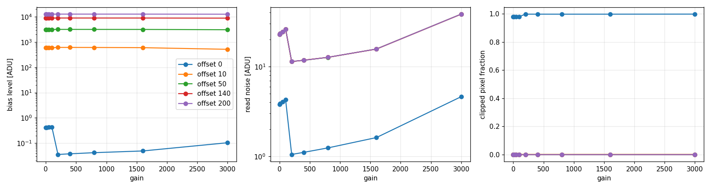

# QHY294PRO-M, serial number cfb85516525f0aced, read mode 1 ("47M MODE")

The same camera as in [../cfb85516525f0aced](../cfb85516525f0aced/README.md), read out in read mode 1 (8336 x 5648 pixels
instead of 4164 x 2822). Measured with `tools/characterize.py --read-mode 1`, which writes into this folder. Everything
else (setup, supply, method) is as in the report of read mode 0. This report is filled in step by step; sections marked
"pending" are still to be measured.

Each statement is marked as **measured**, **inferred** or **from the SDK**.

## Summary

- **Bias noise** is 23 ADU at gain 0 to 10 and 26 ADU at gain 100, about 3 times that of read mode 0, and falls to 11.4
  ADU at gain 200 (measured). The same camera and offset in mode 0 gives 7.2 ADU. See [Bias](#bias-and-read-noise-measured).
- **Readout:** 1.4 to 1.5 s per full frame at USB traffic 0 and 60, independent of binning (measured).
- **Pixels at 20 °C:** same share of noisy pixels as in mode 0 (0.04% above 5x the median noise), but more fixed offset
  pixels (1.1% more than 10 ADU below the level, against 0.001%) (measured).
- Other steps: pending.

## Setup

- Camera properties as reported by the SDK: [meta.json](meta.json). Effective area x 80, y 0, 8336 x 5622 (from the SDK).
- Gain 10 and offset 140 unless stated otherwise, USB traffic 60, 16 bit, lens capped, ambient about 20 °C, cooler off.

## Bias and read noise (measured)

Pairs of bias frames (shortest exposure) at the sensor temperature of the idle camera. Data: [bias.csv](bias.csv).

| Gain | Noise [ADU] | Clipped at offset 0 |
|---|---|---|
| 0 | 22.97 | 98% |
| 10 | 23.28 | 98% |
| 50 | 24.48 | 98% |
| 100 | 26.2 | 98% |
| 200 | 11.4 | 99.8% |
| 400 | 11.8 | 99.8% |
| 800 | 12.7 | 99.8% |
| 1600 | 15.7 | 99.8% |
| 3000 | 38.4 | 99.9% |

- The noise falls from 26 to 11.4 ADU between gain 100 and gain 200. That is the switch of the conversion gain (inferred;
  in read mode 0 the corresponding step is between gain 800 and 1600). A photon transfer measurement would give the noise
  in e-.
- The bias level is `offset * 64 - 38` ADU (602 at offset 10, 8922 at offset 140, 12762 at offset 200), a little below the
  `offset * 64 + 24` of read mode 0. It falls by about 85 ADU from gain 0 to gain 3000 (8922 to 8837).
- **Offset 0 is unusable in read mode 1:** 98% to 99.9% of the pixels are clipped at zero (in mode 0 about 0.2%). Use
  offset 10 or higher.
- The noise does not depend on the offset (offset 10 to 200).

## Readout (measured)

Full effective area (8336 x 5622) read at gain 10 and offset 10 (offset 140 would saturate at bin 4, see mode 0). Data:
[readout.csv](readout.csv).

| USB traffic | Bin 1 [s] | Bin 2 [s] | Bin 4 [s] | Noise bin 1 / 2 / 4 [ADU] |
|---|---|---|---|---|
| 0 | 1.40 | 1.48 | 1.45 | 23.3 / 46.7 / 95.0 |
| 60 | 1.52 | 1.52 | 1.55 | 23.3 / 46.5 / 95.1 |
| 150 | 1.88 | 1.93 | 1.87 | 23.3 / 46.7 / 95.4 |

- A full frame takes 1.4 to 1.5 s at USB traffic 0 and 60, about 2.5 times the 0.6 s of read mode 0 for four times the
  pixels (mode 0: 0.6 s). USB traffic 150 costs 25% more.
- Binning does not make the readout faster, as in mode 0. The noise is 2.0x at bin 2 and 4.1x at bin 4, so the pixels
  are added and the noise grows with the square root of their number, as in mode 0.
- The bias level at offset 10 differs by 10 ADU between the rows (607, 602, 597 at bin 1). It follows the order of the
  runs, not the USB traffic, so it may be a slow drift of the camera (inferred, not checked).

## Pixels at 20 °C (measured)

60 bias frames (shortest exposure) of the whole effective area (8336 x 5622 = 46.9 Mpixel) at gain 10, offset 140, sensor
at 20.2 °C (cooler off). Standard deviation per pixel over the 60 frames. Data: [pixels.csv](pixels.csv). Read mode 0
for comparison (11.6 Mpixel, same settings):

| Quantity | Mode 1 | Mode 0 |
|---|---|---|
| Median per-pixel noise [ADU] | 22.64 | 6.89 |
| Mean / rms per-pixel noise [ADU] | 22.94 / 23.33 | 7.01 / 7.16 |
| 99.9th percentile of the noise [ADU] | 79.7 | 27.7 |
| Pixels with noise above 1.25x the median | 1.8% | 2.2% |
| Pixels with noise above 3x the median | 0.14% | 0.21% |
| Pixels with noise above 5x the median | 0.038% | 0.050% |
| Noisy pixels in the sample on two levels | 3 of 39 | 6 of 47 |
| Pixels whose 60-frame mean is 10 ADU above / below the level | 0.35% / 1.1% | 0.032% / 0.0014% |
| Pixels whose 60-frame mean is 40 ADU above / below the level | 3218 / 253 | 4 / 0 |

- The share of noisy pixels is about the same as in mode 0 (a little lower), so the tail of noisy pixels is not worse
  in the larger mode.
- The 60-frame means scatter more than the noise alone explains. With 22.6 ADU noise the mean of 60 frames has 2.9 ADU
  scatter, so 10 ADU is 3.4 sigma and 0.03% would be expected on each side. Mode 1 has 0.35% above and 1.1% below the
  level, and 3218 pixels more than 40 ADU above it. So there is a fixed pattern (rows, columns or single pixels were not
  examined) that mode 0 does not have in this size. Not checked further.
- The `range_over_45adu` column in `pixels.csv` counts nearly every pixel in mode 1 because the threshold of 45 ADU
  was chosen for the noise of mode 0. Ignore it here.

## Dark current and temperature: pending

## Pixels, cold: pending
